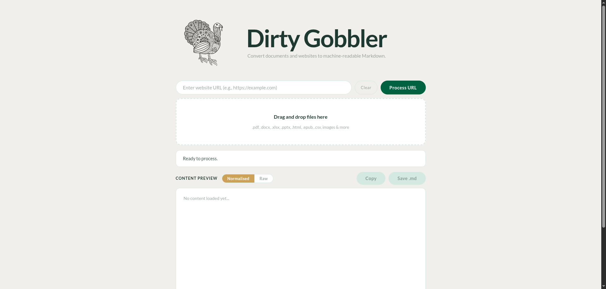

Thanks for your interest in this greedy little repo. Greedy Gobbler is a small personal tool designed to consume and chew up human-friendly media into simple machine-readable Markdown.  It is built to crunch up and remove bloat and padding from information - rendering it into bitesize info pellets suitable for efficient digestion by any LLM via their context window.  It is an efficiency maximiser.

Greedy Gobbler will eat most text-heavy things, including OCR for images and PDFs within the limits of Tesseract. Video files are not supported. For video-to-text, try [Whisper](https://github.com/openai/whisper) locally or upload directly to [Gemini](https://gemini.google.com).



# Greedy Gobbler

Local desktop app that converts documents, ebooks, PDFs, images, and websites into clean Markdown for LLM context windows.
Local files are processed on the device. URL extraction is optional and uses the submitted address; sending the URL to Microlink is a separate opt-in setting.

## Supported input formats

| Input | Extraction path | Notes |
|---|---|---|
| PDF | `pdfplumber` page extraction, structured table capture, and OCR fallback | OCR uses Poppler and Tesseract when a page has no readable native text. Pages remain separate evidence units. |
| EPUB | `EbookLib` spine extraction | Keeps chapter order, code, tables, footnotes and source locations where available. |
| HTML | Local HTML parser | Preserves headings, paragraphs, lists, code and tables. |
| TXT, Markdown, CSV, TSV, JSON, YAML, XML, RTF | Direct text or RTF extraction | Source wording is kept in the raw view. |
| DOCX, XLSX, PPTX and other MarkItDown-supported files | MarkItDown | Extraction quality depends on the source format and its structure. |
| JPG, PNG, TIFF and BMP | Tesseract OCR | OCR text can contain recognition errors and does not interpret images. |
| MOBI, AZW, FB2, LRF, HTMLZ | Calibre `ebook-convert` | Optional system dependency. |
| DjVu | `djvutxt` | Optional system dependency. |

Video is not supported. For video-to-text, use a separate transcription tool.

Website extraction is disabled for private, loopback and reserved network addresses. Crawling can follow same-host links to a maximum of 25 pages. Browser rendering requires the optional browser dependencies. The Microlink option is off by default and sends the requested page address to that service; local files are never sent to it.

## Features

- Drag-and-drop document upload and optional URL extraction
- Faithful raw text and conservative cleaned text previews
- Context preparation in faithful, balanced or focused mode
- A token budget, optional model-window reserves, and an optional UTF-8 byte bound when exact tokenizer data is unavailable
- Source-backed selected and omitted evidence, with unit and location metadata
- Three independent editable drafts: raw, cleaned and prepared context
- Copy the active draft or save it as a new `.md` file
- Optional experimental LLMLingua-2 compression using a model already stored locally

## Installation

New to GitHub or running a local app? Follow the short [beginner installation guide](INSTALL.md) first. You can download the public project without a GitHub account or Git.

1. Open the [Greedy Gobbler repository](https://github.com/TidyWeb/GreedyGobbler), choose **Code → Download ZIP**, and save the ZIP file.
2. Find the ZIP in Downloads, extract it, then move the extracted folder somewhere you can keep it.
3. Open the extracted folder, then open the project folder inside it if needed. Stop when you can see `app.py`, `README.md`, `requirements.txt` and `docker-compose.yml`.
4. Open a terminal or command window in that folder. There is no one-click installer.
5. Choose [Docker](#running-with-docker) or [Python without Docker](#running-without-docker) below.

## Running with Docker

Requires Docker with Compose or a compatible Compose provider. Docker includes the Python app dependencies and the system tools used for PDF and image OCR. On Windows, install Docker Desktop with Compose; the same command can be entered in PowerShell from the project folder. See the [official Docker installation guide](https://docs.docker.com/get-started/get-docker/) if Docker is not installed.

```bash
docker compose up --build
```

When the terminal reports that the app is running, open [http://127.0.0.1:5001](http://127.0.0.1:5001). Keep the terminal open while using the app; press **Ctrl+C** there to stop it. To start it again, open a terminal in the project folder and run `docker compose up`. The service binds to loopback on the host. Saved exports use the named `greedygobbler-data` volume.

The image preloads the `cl100k_base` and `o200k_base` tokenizer data during its build. Browser support and learned compression are optional build arguments: set `INSTALL_BROWSER=true` or `INSTALL_COMPRESSION=true` when building. Browser installation also needs its browser setup step. Compression additionally needs a local model path configured through `COMPRESSOR_MODEL`.

## Running without Docker

This route uses Python 3.11 or newer. The commands below are for a Linux or macOS terminal opened in the project folder. Python installs the app's Python packages; OCR for scanned PDFs and images also needs Poppler and Tesseract installed separately on your system. Native Windows Python setup is not covered here; on Windows, use the Docker route above.

```bash
python3 -m venv .venv
.venv/bin/python -m pip install -r requirements.txt
mkdir -p "${XDG_CACHE_HOME:-$HOME/.cache}/greedygobbler/tokenizers"
TIKTOKEN_CACHE_DIR="${XDG_CACHE_HOME:-$HOME/.cache}/greedygobbler/tokenizers" \
  .venv/bin/python -c "import tiktoken; tiktoken.get_encoding('cl100k_base'); tiktoken.get_encoding('o200k_base')"
.venv/bin/python app.py
```

The explicit tokenizer setup downloads only the small tokenizer data files. The application itself does not fetch missing tokenizer data or model weights. If exact tokenizer data is unavailable, select the clearly labelled UTF-8 byte-bound option.

When the terminal reports that the app is running, open [http://127.0.0.1:5001](http://127.0.0.1:5001). Keep that terminal open while using the app; press **Ctrl+C** to stop it. To start it again, return to the project folder and run `.venv/bin/python app.py`. Set `PORT` to use a different port. The default save folder is `~/Downloads/GreedyGobbler`; set `SAVE_DIR` and `TEMP_DIR` to change the local storage locations.

## Design and validation

- [Architecture](docs/architecture.md) describes extraction, normalisation, packing and trust boundaries.
- [Development setup](docs/development.md) covers tests, optional engines and local configuration.
- [Validation report](docs/validation.md) records the exercised versions, fixtures, results and skipped paths.
- [Compression evaluation](docs/compression-evaluation.md) explains the offline evidence proxies and their limits.

## Project structure

```text
app.py              Flask routes and request validation
converter.py        Extraction orchestration and backwards-compatible wrapper
pipeline/
  extraction.py     File extraction and PDF/scan handling
  normaliser.py     Conservative Markdown clean-up
  web_fetch.py      Bounded website fetching and address checks
  context.py        Evidence selection and context packing
static/             Vanilla JavaScript interface
tests/              Unit and integration tests
benchmarks/         Offline fixtures and benchmark runner
docs/               Architecture, setup and validation notes
```
